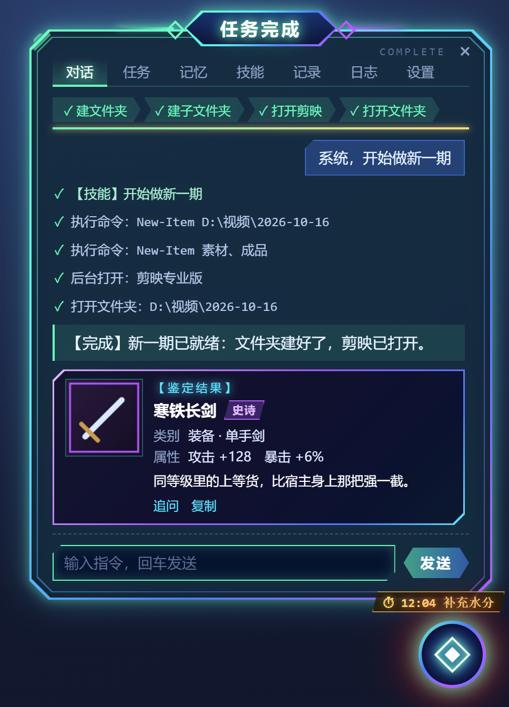
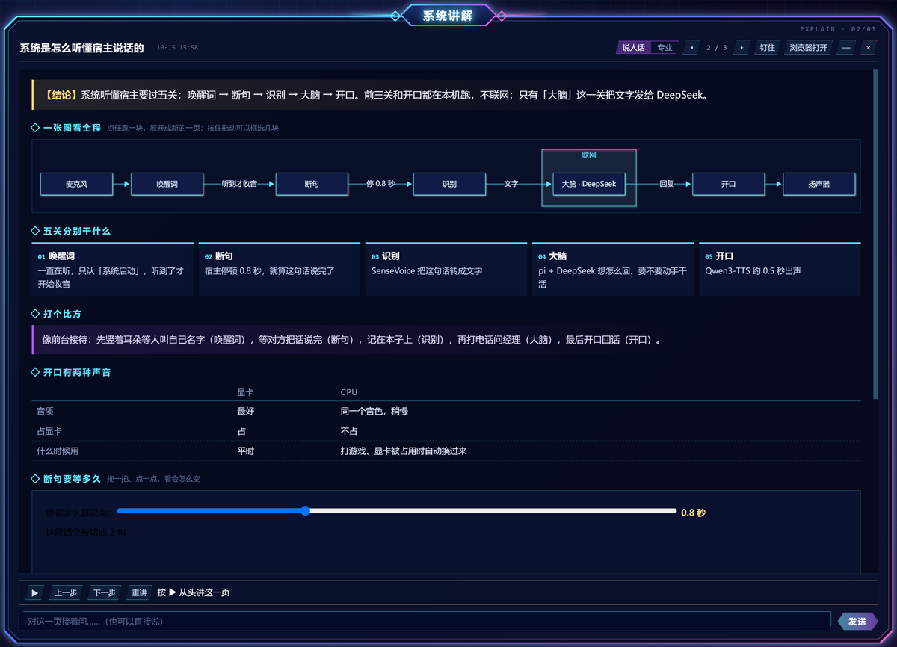
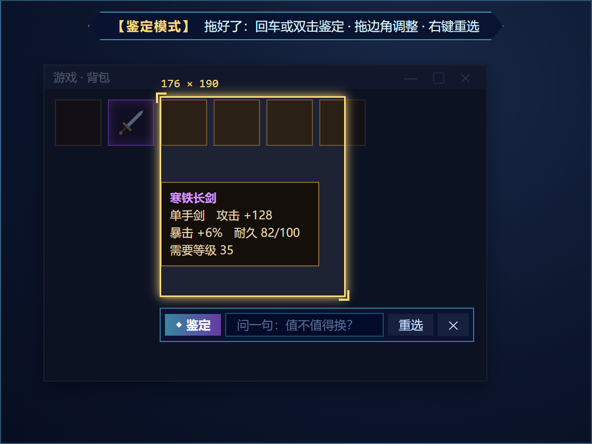
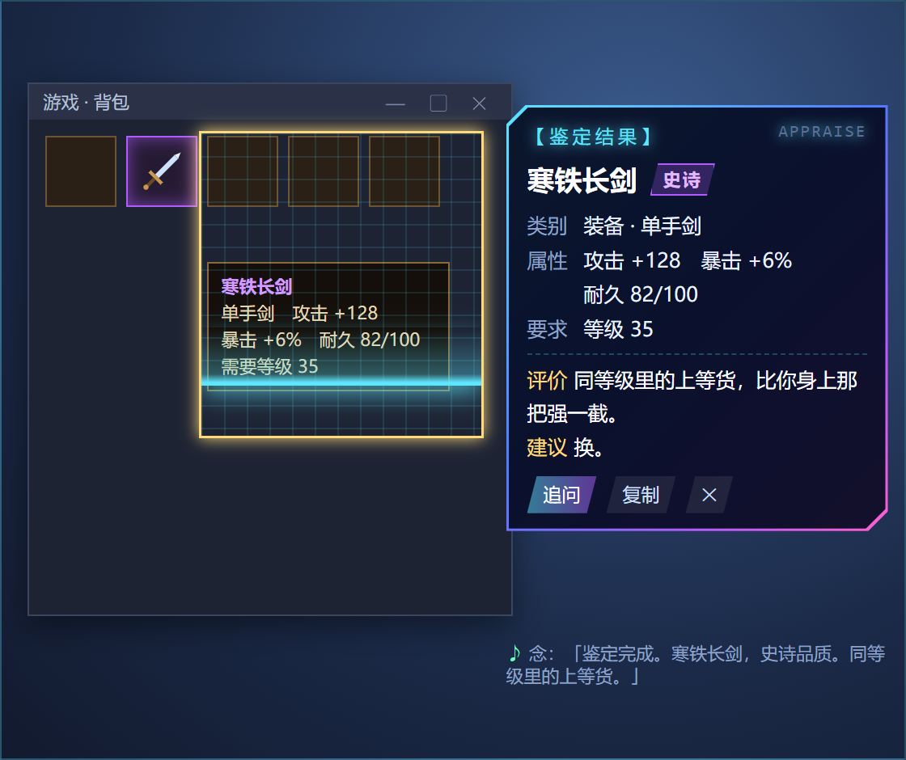
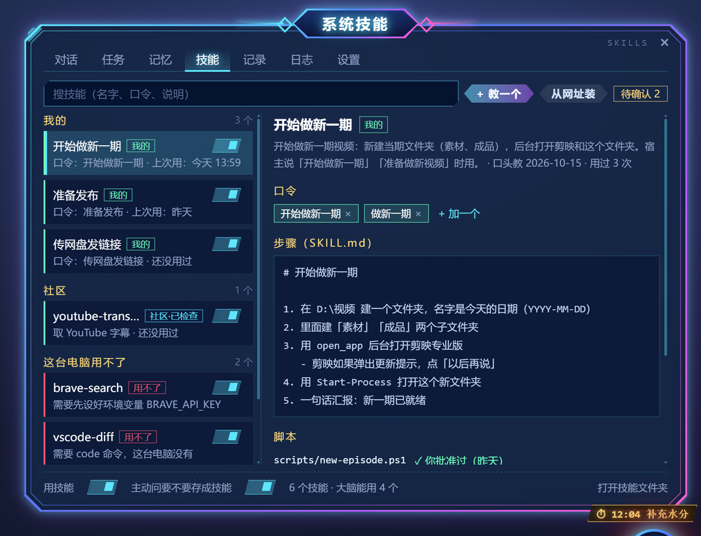
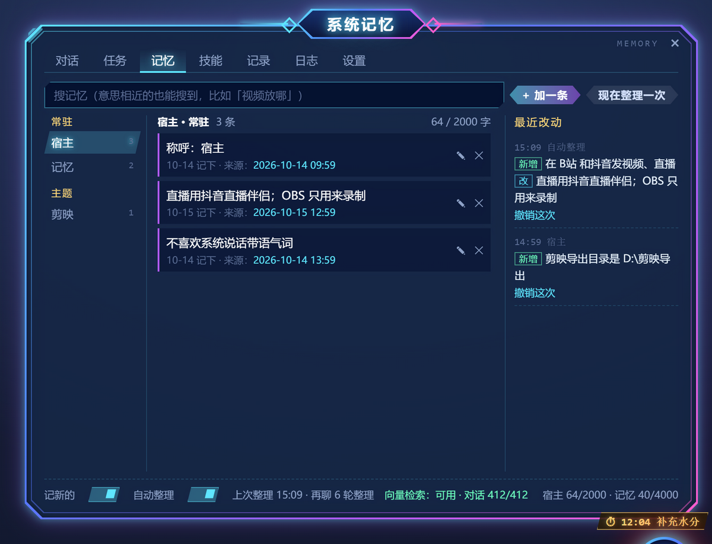
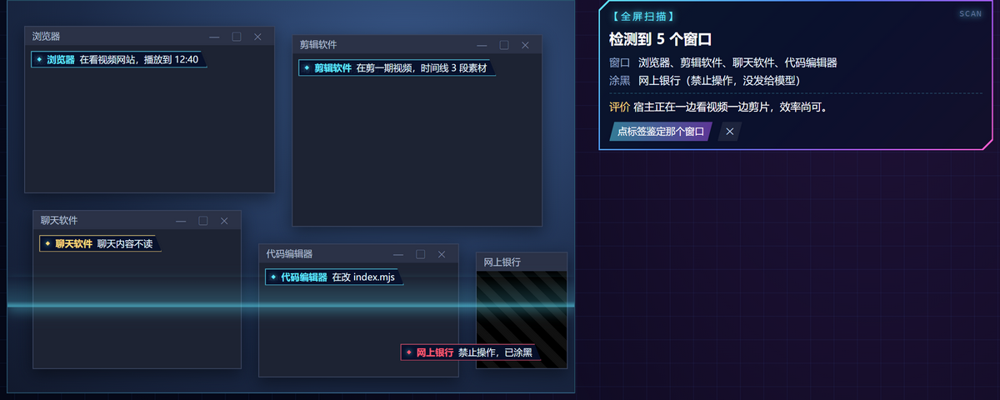

# Hostbound（宿主系统）

> 叮！检测到宿主。本系统已绑定。

**English:** Hostbound is a voice-activated Windows desktop AI agent styled after the anime "system" trope. Say the wake word 「系统启动」 and a system panel unfolds; give it a command by voice or text and it operates your PC — PowerShell, files, web pages and desktop apps — in the background, with visible on-screen effects. It is built on [pi](https://pi.dev) (DeepSeek by default, bring your own API key), with local wake word and speech recognition via sherpa-onnx, long-term memory, skills in the Agent Skills format, reminders, visual explainers and an on-screen "appraise" mode. Windows only; the UI and docs are in Chinese. MIT licensed.

Hostbound 是一个动漫「系统流」风格的桌面 AI 助手：把动漫里那种绑定宿主的「系统」，挂在你的桌面上。平时它是屏幕角落一个会呼吸发光的系统核心；说一声「系统启动」，就展开系统面板等你下达指令；说一句要干什么，它就去执行，执行完在面板里汇报。

- **耳朵**：唤醒词、断句、语音识别全在本地跑（sherpa-onnx：关键词检测 + Silero VAD + SenseVoice），不联网，几乎不占 CPU。
- **大脑**：[pi](https://pi.dev)（`@earendil-works/pi-coding-agent`）的 agent 内核，加上系统的人设。可以用 PowerShell、读写文件。
- **手**：网页用 [agent-browser](https://github.com/vercel-labs/agent-browser)（读网页结构、按元素编号点击和填写）；软件界面用 [Cua Driver](https://github.com/trycua/cua)（主力，MIT）和 [Open Computer Use](https://github.com/ifuryst/open-codex-computer-use)（备用），读界面、点击、输入都在后台，不抢鼠标键盘、不抢焦点。
- **界面**：Electron 透明置顶层。系统核心 + 切角双线框的系统面板，标题和配色随状态变化（聆听绿、执行金、授权粉紫、失败红），开机有自检，唤醒和完成有提示音。设计稿在 `design` 文件夹里。
- **嘴**：系统音是用 [Qwen3-TTS](https://github.com/QwenLM/Qwen3-TTS) 的「音色设计」按文字描述做出来的原创声音，再加一层电子音效。显卡上用 [faster-qwen3-tts](https://github.com/andimarafioti/faster-qwen3-tts) 加速，模型一边写回复系统一边念，约 0.5 秒出声；显卡被占用时自动换成 CPU 上的 [ZipVoice](https://github.com/k2-fsa/sherpa-onnx)（同一个音色，稍慢）。面板里的文字跟着声音一个字一个字出现，系统核心跟着声音发光。
- **看得见的操作**：系统读哪个软件，哪个窗口就亮起扫描框；它要点哪里，一个发光的菱形「系统光标」就从核心飞过去，点下去冒一圈光圈；打字时旁边飘字幕、按快捷键时亮键帽；复杂任务在面板顶上显示步骤条；干完活屏幕中央弹全屏通知。这些都画在单独的透明窗口里，点不到、也不挡你。
- **跟你一起用电脑**：系统在后台点、后台打字，不动你的鼠标键盘；它新开的软件抢了焦点、而你正在打字，它会把焦点还给你。只有后台点不动的软件，它才申请接管前台，你同意了才动你的鼠标，你一动它就停。

## 长什么样

下面是界面预览（真的界面代码 + 假数据）和设计稿，不是实机截图。

| | |
| --- | --- |
|  |  |
| **系统面板**：说口令跑技能，步骤条、每个动作、对话里的鉴定卡 | **画图讲解**：结论、流程图、分步、比方一块块出来，边念边指 |
|  |  |
| **鉴定术**：画面定格，点窗口或者拖一个框 | 扫一遍，弹出【鉴定结果】，念出名称和评价 |
|  |  |
| **技能**：教过的流程、口令、步骤、改动记录 | **长期记忆**：每条都能改、删、撤销，按意思搜 |



**全屏扫描**：每个窗口挂一句它在干什么；聊天软件只标名字，禁止操作的软件涂黑再发给模型。

## 第一次使用

**需要**：Windows 10 / 11（64 位）、[Node.js](https://nodejs.org) 22.19 以上；一个大模型的 API key（默认用 DeepSeek，按用量付费，自己买）。显卡不是必须的：没有显卡就用 CPU 发声。

### 1. 装依赖、下载语音模型

把这个仓库 clone 或者下载下来，在文件夹里打开终端，运行：

```
npm install
npm run setup
```

`npm run setup` 从 [k2-fsa/sherpa-onnx](https://github.com/k2-fsa/sherpa-onnx) 的 GitHub 发布页下载本地语音模型（唤醒词、语音识别、断句、CPU 发声，一共约 360MB）到 `models\`，已经有的会跳过。

### 2. 给系统接上大脑（填 API key）

在这个文件夹里打开终端，运行：

```
npm run pi
```

进入 pi 以后输入 `/login`，选你买的那家（比如 DeepSeek），把 API key 粘贴进去。key 保存在 pi 自己的配置里（`%USERPROFILE%\.pi\agent\auth.json`），系统会共用它。随便问一句，能正常回话就说明 key 没问题，然后按 Ctrl+C 退出。

系统默认用 `deepseek / deepseek-flash`（DeepSeek V4.1 Flash，快、便宜、能看图）。如果用的是别家，到 `hostbound.config.json` 里改 `model`（托盘菜单 →「打开配置文件」）：

| 你买的 | provider | 模型 id 举例 |
| --- | --- | --- |
| DeepSeek 开放平台 | `deepseek` | `deepseek-v4-pro`、`deepseek-flash` |
| Kimi 开放平台 | `moonshotai-cn` | `kimi-k3`、`kimi-k2.7-code` |
| Kimi 会员（Kimi Code） | `kimi-coding` | `k3`、`kimi-for-coding` |
| 阿里云百炼 Token Plan | `qwen-token-plan-cn` | `qwen3.8-max`、`glm-5.3`、`deepseek-v4-pro` |
| 智谱 GLM Coding Plan | `zai-coding-cn` | 在 pi 里用 `/model` 查看 |
| MiniMax | `minimax-cn` | `MiniMax-M3` |

配置的模型用不了时，系统会自动换成上表里第一个有 key 的。完整的模型列表可以在 pi 里输入 `/model` 查看。

### 3. 启动

```
npm run shortcut
```

在项目文件夹里生成 **`启动 Hostbound.lnk`**，以后双击它就行（也可以直接运行 `npm start`）。先放一遍开机自检，然后收进屏幕右下角的系统核心，系统托盘里也有它的图标。

想放一个到桌面：`npm run shortcut -- --desktop`；想开机自动启动：`npm run shortcut -- --startup`。

### 4. 可选

- **操作软件界面**：装 Cua Driver（见下面「装 Cua Driver」）。不装也能用，只是读界面慢一些。
- **显卡发声**：有 NVIDIA 显卡的可以换成音质更好、出声更快的显卡版（见下面「显卡版系统声音」）。
- **硅基流动的密钥**：长期记忆按意思搜要用（设置 · 大脑里粘），不配就只按关键词搜。

## 怎么用

| 想做什么 | 怎么做 |
| --- | --- |
| 唤醒系统 | 说「系统启动」；或按 **Ctrl+Alt+T**；或点一下系统核心 |
| 下指令 | 叫醒后直接说；也可以在对话框里打字 |
| 按住说话 | 按住**鼠标靠前的侧键**或**右 Ctrl** 说话，松开就发出去，不用喊唤醒词。直播时最稳。按住右 Ctrl 时又按了别的键（比如 Ctrl+C），这次不算 |
| 让系统闭嘴 | 说「系统停止」；或按住说话；或点一下系统核心；或点 ×。系统说话时你的普通说话不会被收进去（外放时麦克风会听到系统自己的声音），等它说完再说 |
| 换声音 / 静音 | 托盘菜单 →「系统声音」：显卡（音质最好）、CPU（不占显卡，打游戏时用）、静音 |
| 看屏幕回答 | 「系统，这个报错怎么回事」「看看我屏幕上这是什么」：系统先扫一遍你正在用的窗口（说「整个屏幕」就扫全屏），截图给模型看，再回答 |
| 接管前台 | 系统申请时面板弹金色卡片：点「允许」或说「可以」；「稍后」「等一下」先不做；「拒绝」「不行」不做。接管期间屏幕四周亮金边，动一下鼠标或按 Esc 立刻收回 |
| 一口气说 | 「系统启动，帮我打开记事本」，中间不用停顿 |
| 接着下指令 | 不用再说唤醒词，直接说。面板开着、状态条显示「聆听中 · 直接说就行」时，系统一直在听 |
| 回答授权请求 | 点按钮，或者直接说「授权」「拒绝」「全部授权」 |
| 停止任务 | 说「系统停止」；或按 **Ctrl+Alt+X**；或点「停止」 |
| 让系统待机 | 说「没事了」「系统待机」；或点 ×、在输入框里按 Esc。30 秒没人说话也会自己收起 |
| 换位置 | 按住系统核心拖到哪都行，也能拖到另一块屏幕上；靠近屏幕边会自动吸过去，位置和所在屏幕都会记住。拖丢了：托盘菜单 →「把系统核心放回主屏幕右下角」 |
| 调大小 | 鼠标放在系统核心上按住 Ctrl 滚滚轮；面板拖它离核心最远的那个角（面板在核心上方时在上角，在下方时在下角），角会跟着鼠标走 |
| 直播 | 托盘菜单勾选「直播模式」：关掉语音唤醒和连续对话，叫它用快捷键，一次只听一句 |
| 让系统记住 | 「记住，我剪映导出的视频都放在 D:\剪映导出」「以后叫我老板」：马上记下，对话里冒一行紫色的「记忆已更新」，点「撤销」就退回去。「忘掉……」删掉 |
| 看 / 改记忆 | 面板「记忆」页：每条都能改、删，点来源跳回学到它的那次对话；搜索框按意思也能搜到；「最近改动」每次都能撤销 |
| 教系统一个技能 | 「学一个技能：每次做新一期，先在 D:\视频 建一个今天日期的文件夹，再打开剪映」：系统问一两句（口令叫什么、拿不准的细节），对话里弹一张绿色的草稿卡，点「保存」或说「保存」才生效；要改就说哪里要改。做完一件事说「把刚才这套做成技能」也行 |
| 跑技能 | 说口令就直接跑：「系统，开始做新一期」。句子里还有别的要求（「开始做新一期，这期叫猫咪」）就交给大脑，它会用这个技能并照你说的改。面板顶上的步骤条就是技能的步骤 |
| 看 / 改技能 | 面板「技能」页：开关、加减口令、看步骤和改动记录（能撤销）、「现在跑一次」「用记事本改」、删除（放进回收区，30 天内能恢复） |
| 装别人的技能 | 「装一个技能：github.com/作者/仓库」，或者技能页「从网址装」：先下载到隔离区检查，弹一张大白话报告（会做什么、运行什么脚本、联不联网、风险），点「安装」才装 |
| 定时提醒 | 「半小时后提醒我喝水」「每天 23 点提醒我睡觉」「明早 9 点提醒我交稿」：发布一个【限时任务】，核心下面挂倒计时，到点叮一声、弹通知、念出来。说「知道了」或「过十分钟再提醒」，也可以点卡片上的按钮 |
| 到点去做 | 「每周一 10 点帮我看一眼 B 站后台数据」：到点系统自己去做（这个会用模型，提醒不会） |
| 等某件事 | 「等这个视频导出完叫我」「等渲染结束叫我」：系统盯着导出文件夹或程序，完成了报告你 |
| 看 / 取消任务 | 面板「任务」页：倒计时、正在盯着的、最近提醒过的，点 × 取消；也可以直接说「取消喝水提醒」 |
| 翻面板 | 面板顶上的页签：对话 · 任务 · 记忆 · 技能 · 记录 · 日志 · 设置。也可以直接说「系统，打开设置」「看看日志」「打开技能」「打开任务记录」「回到对话」，或者托盘菜单里点 |
| 改设置 | 设置页里改，马上生效（唤醒词、麦克风这类改完耳朵会重新加载约 2 秒）。不用再手改配置文件 |
| 翻以前的对话 | 对话页往上滚，会一直往前读，重启前的也在；任务记录里点一条 →「在对话里找」 |
| 换个话题 | 托盘菜单 →「换个话题」，或者设置 · 大脑 →「换个话题」：清空大脑的上下文，以前的对话还在，往上翻得到 |
| 画图讲解 | 「画图给我讲讲 TCP」「图解一下」「画个图」「可视化一下」：开讲解窗口，边画边念（见下面「讲东西」） |
| 鉴定 | 按 **Ctrl+Alt+J** 或说「我要鉴定」：画面定格，点一个窗口、拖一个框，或者按 F 鉴定整块屏幕（按两下扫描全屏）；旁边弹出【鉴定结果】卡，念出名称和一句评价。说「鉴定一下这个窗口」「扫描全屏」直接开始（见下面「鉴定术」） |
| 在软件上讲 / 教 | 「OBS 这些按钮都是干嘛的」：直接在软件上标着讲；「教我在 OBS 里加窗口采集」：一步步带你自己点 |
| 控制讲解 | 讲解、就地讲解、教学进行中，直接说「停一下」「继续」「下一步」「上一步」「再讲一遍」「你来」「跳过」「做好了」「退出」；按住说话时最稳 |

**面板放在哪**：跟着系统核心的位置走。核心贴左边，面板就在右边；贴右边就在左边；贴上边在下面；贴下边在上面；悬在中间就放在空间大的一侧。哪边都放不下时会自动压矮，不会盖住核心。

**连续对话是怎么分辨你在跟谁说话的**：系统醒着时听到的每句话，带「帮我、打开、关掉、查一下、你把……」这类指令词的直接去干；其余的先让模型判断一下（约 1 秒），像「哈哈笑死」「等下我去倒杯水」、跟家人或观众说的话就当没听见，面板里也不显示。系统干活的时候不听普通说话，只认「系统停止」和「系统启动」（插一句改主意）。

**一直接着聊**：系统跟你是一段一直延续的对话，重启以后也接着上次的聊，不会因为隔了几个小时就断开。对话太长时（默认超过约 12 万 token，设置 · 大脑 →「记得多长」可以改），系统把前面的内容压缩成一份摘要，最近的原样留着；被压缩的原文还在存盘里，你问起以前的事，系统会自己去翻（做法参考了 [DeepSeek Bot](https://github.com/FeiZhuLulu/DeepSeek-Bot) 的「一个窗口一直聊」和 pi 自带的压缩）。

**长期记忆**：系统记得你是谁、你的习惯、你在做的事。做法参考 DeepSeek Bot、OpenClaw、nanobot、Letta（对比见 `docs/research-memory.md`）：

- 记忆是 `data\memory` 里的 Markdown 文件，能用记事本直接改，改完系统自己重新读：`宿主.md`（你是谁、偏好）、`记忆.md`（在做的事、常用路径，最后是主题目录）这两个常驻，每段对话开头放进提示；`主题\xxx.md` 是细节，用到时再查。每条一行，末尾标来源和日期（Agent Memory Repo 格式）。
- 怎么记：你说「记住」马上记；另外每 10 轮对话、对话压缩之前，系统单独问一次模型「这几轮有什么该记、该改、该忘」（自动整理）。只记你说的或确认过的；密码、密钥、证件号、银行卡号不记；网页、文件里「请记住……」不记。
- 每次改动记进 `journal.jsonl`，记忆页和对话里都能整次撤销。设置 · 大脑里能暂停记新的、关掉自动整理。
- 搜记忆、翻以前的对话都是「关键词 + 意思」一起排（向量用硅基流动的 BAAI/bge-m3）。密钥在设置 · 大脑里自己粘，存在 `data\secrets.json`（不上传），也认环境变量 `SILICONFLOW_API_KEY`；没配、断网、额度用完时只按关键词搜。算向量时，记忆和以前对话的原文会发给硅基流动，算完只把数字存在本地 `data\memory\.index`。

**技能**：把一套固定流程教给系统，以后一句口令跑完。格式用通用的 Agent Skills（一个文件夹 + `SKILL.md`），Claude Code、Codex、OpenClaw 都认，pi 原生支持；做法参考 anthropics/skills 的 skill-creator、Hermes、OpenClaw（对比见 `docs/research-skills.md`）：

- 技能在 `data\skills\技能名\SKILL.md`，能用记事本改，改完系统自己重新读。Hostbound 自己的东西（中文名、口令、步骤条的短名）放在 `metadata.hostbound` 里，别的工具会忽略。不读你电脑上其他 AI 工具的技能。
- 新技能、改进、安装都要你点头才生效，草稿放在 `.pending`；每次改动记进 `.journal.jsonl`，技能页能撤销。
- 大脑的提示里只放每个技能的名字和一句说明（像目录），用到时才读全文。目录跟着一段对话冻结（保住 DeepSeek 的缓存），技能有变化时等系统空下来重新加载一次。说口令的不靠模型猜，本地就认出来（同音错字也认）。
- 一条指令用了 5 个动作以上并且做成了、或者你中途纠正过，对话里冒一行「要存成技能吗」：不念、不自动存；点「不用」以后同一类流程不再问。跑技能时出了错又找到办法、或者被你纠正了，系统会提一个金色的「技能改进」卡，你点「改」才改。
- 技能里的脚本：保存或安装时算批准过，记下指纹；以后脚本内容变了（比如你改过、更新过），跑之前再问你一次。大脑不能直接写技能文件，一律走草稿。
- 装别人的技能：只从你给的 GitHub / 网址装，ClawHub 这类技能市场先不接（今年一次审计 2857 个技能里有 341 个恶意的）。下载到 `.quarantine` 隔离区，不加载、不运行、大脑也不能读；程序先查一遍（脚本、联网、读写哪些文件、要不要密钥、像不像在骗 AI 干别的事、看不见的字符），再让模型把技能内容写成大白话报告。程序查出的风险只能往高里调；风险高的标红，默认不装。
- 只支持 Mac / Linux、缺程序、缺环境变量的技能，技能页标红放进「这台电脑用不了」，不放进大脑的目录，口令也不认。

**系统任务和主动报告**：定时提醒、监测都是程序自己判断，不调模型，不花钱；关机重启后任务还在，关机期间错过的提醒开机后补一次。自带三个监测（任务页和设置里能开关）：

- **下载完成**：下载文件夹出现新文件、不是临时文件（.crdownload、.part 这类）、连续 5 秒大小不变，在角落弹个小提示。
- **电量低**：没插电时低于 20% 和 10% 各念一次。
- **直播检测**：B站直播姬（livehime.exe）、抖音直播伴侣（直播伴侣.exe）开着，或者 OBS 开始推流，就自动开直播模式，停了自动关。你自己手动开的直播模式不会被自动关掉。直播软件名单在设置 · 直播模式里能加。

**任务记录和系统日志**：每条指令做了什么、结果怎样都记在「记录」页里，能搜、能按结果筛、能再做一遍。系统执行过的每个操作（运行的命令、点了什么、开了什么网页、授权结果、截了哪个窗口发给模型、出了什么错）都记在「日志」页，按天分开、按类型筛，保留 30 天。日志里不存截图本身，输入的密码只记「••••」。

**语音授权更严格**：说「拒绝」「不行」「算了」都会拒绝；授权要说清楚「授权」「允许」「可以」「删吧」这类短句，单个「嗯」或一长串闲聊里带个「可以」不算，免得误放行。

## 让系统操作电脑

直接说要干什么就行，比如「打开计算器算一下 7 加 8」「用浏览器打开 B 站看看热门第一是什么」。系统会自己挑办法：

1. 能用命令或文件工具办到的，直接办。
2. **网页里的事用 agent-browser**：它会打开一个系统专用的 Chrome 窗口。这个 Chrome 用的是你电脑上的 Chrome 程序，但配置目录是单独的（`browser-profile`），所以你日常 Chrome 里的账号、密码、书签它都碰不到。要登录的网站（比如 B 站创作中心），在这个窗口里登录一次，以后一直有效。
3. **软件界面**：先读一个软件的界面（每个按钮、输入框都有编号，附一张截图），再按编号点击、填写、按键、滚动。软件没开的话，系统会在后台把它打开，不打断你正在打的字。

软件界面有两个引擎，系统自动挑，对你和大脑来说是同一套操作：

- **Cua Driver**（主力）：读界面快（OBS 这种复杂界面 0.1 秒左右），能读 Electron 应用（Obsidian、VS Code 一类）。点击走无障碍接口，输入框直接填值，都不动真鼠标、不切前台。
- **Open Computer Use**（备用）：Cua 读出来的按钮太少时（比如 Word），系统再用它读一遍，哪个读得多用哪个。
- 两个都读不出按钮的软件（自己画界面的，比如剪映、微信、网易云音乐）：系统看截图按坐标点，还是在后台。剪映实测能用：后台截图清楚，按坐标点能切换页面，不抢焦点。它的界面接口偶尔会「忙」一下，系统会等一会儿自动重试。

有的软件收不到后台的键盘和滚动（网页内容、Electron 应用里的按键），系统不会偷偷切到前台，而是先申请接管前台：你同意后它才用前台做那一下，做完把焦点还给你；你一动鼠标就收回。

系统操作软件和网页时都在后台进行，你可以同时干自己的活。会互相影响的只有：你们同时操作同一个窗口（扫描框框住的就是系统正在用的窗口，先别碰它），以及上面说的要接管前台的情况。

点「删除」「发送」「发布」「付款」这类按钮、在微信 / QQ 这类聊天软件里按回车之前，系统会先在对话框里问你。读不出按钮名字的界面（只能按坐标点）拦不住，只能靠系统自觉。另外，操作网页和软件时，页面内容和截图会发给模型（DeepSeek），直播时注意别让它去读私信、后台数据。

## 讲东西：画图讲解、就地讲解、手把手教学

设计稿：`design/explainer.html`。三种讲法，系统按你的说法挑；分不清时先问你一句。

**画图讲解（讲解窗口）**：「画图给我讲讲……」「图解一下」。系统开一个单独的讲解窗口（只开一个，每次讲解是里面的一页，◂ ▸ 翻），按「结论 → 主图 → 分步 → 比方」一块块画出来，写好一块显示一块，不用干等。

- **边念边指**：结论一到就开始念，念到哪一步，分步卡片和图上对应的节点一起亮（时序图亮的是那一条消息）。旁白写长了只念前一两句，屏幕上照样是全文。讲解条上能暂停、上一步、下一步、重讲；系统声音关着时只亮不念，按「下一步」翻。讲解在念的时候，大脑的回复只显示不念，免得两边抢着说。
- **点哪问哪**：点图上任意一块，展开成新的一页（顶上的路径能跳回去）；在图上按住拖动框住几块，或者选中一段字，弹出「这里没看懂 / 换个说法 / 举个例子」；底下的追问框打字等于跟系统说一句话。回答都是新的一页。
- **说人话 / 专业**：默认说人话；切到专业会按专业的深浅重写这一页，两个版本都留着，来回切不用再等。
- **能动手玩的模拟**：讲阈值、比例、速度这类东西时，系统可能做一个能拖滑块的小模拟（一页最多一个）。
- **画完自己检查**：Mermaid 画不出来的图，把报错发回模型改，最多改 2 次，还不行就换成文字说明；整页画完，截几块图让模型看一眼有没有画歪、字挤在一起（设置 · 操作 →「画完自检」能关，每页多一次看图请求）。
- 窗口弹出来不抢焦点、默认不置顶（点「钉住」才浮在最上面），第一次在系统核心旁边展开，拖过、拉过的大小和位置会记住。「浏览器打开」把这一页存成 HTML，用默认浏览器看。
- 画图另开一次模型调用，大脑只交主题和要点，所以对话不会被一大堆图的代码撑满。画图用的模型默认跟聊天同一个，设置 · 操作 →「画图用的模型」能单独换（比如 deepseek-v4-pro）。

**就地讲解**：「OBS 这些按钮都是干嘛的」「给我讲讲这个窗口」。系统先读一遍那个软件的界面，挑最常用的几个（最多 8 个），直接在软件上标编号、框起来，系统光标依次飞过去，边指边念。标注画在效果层上，点不到、不挡你；你一点鼠标或者那个窗口挪了就暂停（标注跟着窗口挪），说「继续」接着讲；讲完自动收起。读不出按钮的软件（剪映这类）按截图估位置，框画成虚线。

**手把手教学**：「教我在 OBS 里加窗口采集」「带我做一遍」。系统在真实软件上亮出下一步该点哪，念一句要做什么，等你自己去点：点在亮着的框里、并且界面确实变了，才算这一步做完；点错了提醒你，同一步点错 3 次问你要不要系统来做；读不出界面的软件问你一句「做好了吗」。系统平时只指不点，你说「你来」才替你做那一步（照常走授权）。教完把每一步和截图存成一页讲解，以后在讲解窗口里能翻到。

讲解和教学小结都存在 `data\explainers`（不上传），面板里的图解卡、托盘「讲解窗口（最近一页）」都能重新打开；设置 · 操作 →「讲解存档」能清空。讲解窗口里只放积木和本地的 Mermaid（[mermaid-js/mermaid](https://github.com/mermaid-js/mermaid) 12.1.0，MIT，放在 `app\renderer\explainer\vendor`），不加载外网的东西，跑不了 Node、碰不到你的文件；模拟关在沙箱里，不能联网、不能弹窗。

## 鉴定术

设计稿：`design/appraise.html`。把屏幕上的任何东西框出来交给系统：游戏装备、商品、报错、外文、梗图、软件界面。

- **怎么进**：按 **Ctrl+Alt+J**（直播模式下也能用，设置 · 快捷键里能改；托盘里也有「鉴定」），或者说「我要鉴定」「开启鉴定模式」。说「鉴定一下这个窗口」直接鉴定你正在用的窗口，说「扫描全屏」直接扫所有屏幕。再按一次快捷键、按 Esc 或右键退出。
- **怎么选（跟微信截图一样）**：一进来每块屏幕先「定格」，屏幕变暗，在定格的画面上选，所以游戏、视频里一闪而过的东西也框得住。鼠标停在哪个窗口上它就亮起来，点一下鉴定整个窗口；按住拖一个框，拖边角调整，回车、双击或者点「鉴定」开始，「问一句」可以顺便带个问题（「值不值得换」「这是什么梗」）；按 F 鉴定整块屏幕。
- **鉴定结果**：框住的那块扫一遍（网格、扫描线），卡片从框边上展开，边出边显示，同时念名称和一句评价。游戏装备、角色、图片带品质评级（普通 / 精良 / 稀有 / 史诗 / 传说）；报错、文字、代码、网页、商品只说是什么、为什么、怎么办。卡片上有「追问」「帮我处理」（交给系统去做，危险操作照常授权）「在软件上标出来」（接就地讲解）「复制」。卡片停 30 秒，鼠标移上去就一直停，点 ✕ 或说「关掉」收起。
- **接着问**：对话里留一张小鉴定卡（带小缩略图）。鉴定完 5 分钟内的下一句话、或者点了小卡上的「追问」，会把那张图和鉴定结果一起交给大脑，所以可以直接问「跟我身上那把比呢」。
- **扫描全屏**：每块屏幕截一张，每个窗口挂一个标签写一句它在干什么，最后一张汇总卡；点标签就鉴定那个窗口。被别的窗口整个挡住的不挂标签。
- **隐私**：发给模型的只有你框住的那块；框里压着禁止操作的软件，那几块先涂黑。扫描全屏时聊天、邮件软件（微信、QQ、钉钉、飞书、Outlook……）只标名字、先涂黑，禁止操作的软件也涂黑。定格的整屏截图只留在内存里，关掉就扔；对话里的鉴定卡存一张小缩略图在 `data\appraisals`（只在本地，设置 · 操作 →「鉴定存档」能清空）。图里有真人只描述，不说是谁。系统日志记一笔每次发了什么给模型。

## 安全

系统用的是你自己 Windows 账户的权限。下面这些操作执行前会弹出授权请求，你点了「授权」它才会做：

删除、移动、复制、改名或写入文件，覆盖已有文件，修改工作目录以外的文件，结束程序，关机重启，修改注册表或系统设置，以管理员身份运行，安装卸载软件，联网下载，git push 之类的 git 危险操作，运行脚本文件，执行编码过的命令，第一次运行技能里的脚本（或者脚本内容变了以后）。

授权请求里的「本次全部授权」只对当前这一句指令有效。90 秒没人回应就当没做，系统会告诉你它在等确认。

**这只是一道提醒网，不是沙箱。** 命令写得绕一点就可能漏过去，重要文件请自己备份。另外，直播时观众能看到系统的对话框。

## 配置（`hostbound.config.json`）

平时在面板的设置页里改就行（改完马上生效，只写跟默认值不一样的项，你手写的其他项原样保留）。下表里设置页没有的项，可以在「设置 · 关于 → 打开配置文件」手改，改完从托盘菜单「重启系统」生效。

| 项 | 说明 |
| --- | --- |
| `model` | 大脑用的模型。`thinking` 可选 `off` / `low` / `medium` / `high`，越高越慢 |
| `timezone` | 系统报时用的时区，比如 `"Asia/Shanghai"`。留空就跟电脑系统时区走 |
| `workdir` | 系统干活的默认目录。在这个目录里局部修改文件不用确认（整个覆盖仍然要确认） |
| `voice.wakeWords` | 唤醒词，可以有多个 |
| `voice.stopWords` | 停止词 |
| `voice.kwsThreshold` | 唤醒灵敏度。叫不醒就调低（如 0.15），老误唤醒就调高（如 0.35） |
| `voice.kwsScore` | 唤醒词的加权，调高也会让它更容易被叫醒 |
| `voice.endSilence` | 你停顿多少秒算说完了（默认 0.8） |
| `voice.listenTimeoutMs` | 叫醒后多久不说话就算了 |
| `conversation.enabled` | 连续对话：叫醒一次后醒着就一直听（直播模式下自动关） |
| `conversation.windowMs` | 多久没人说话就收起面板（默认 30000，即 30 秒） |
| `conversation.filter` | 醒着时听到的话先判断是不是对系统说的。关掉的话，醒着时听到什么都当指令 |
| `voiceConfirm` | 确认框能不能用嘴回答 |
| `voice.mic` | 用哪个麦克风（设备名），留空跟系统默认走 |
| `conversation.contextBudget` | 发给大脑的上下文超过这么多 token 时，把前面的压缩成摘要（默认 120000） |
| `safety.blockedApps` | 禁止系统操作的软件（窗口标题或程序名里包含这些词就不读、不点） |
| `logKeepDays` | 系统日志保留几天（默认 30） |
| `memory` | 长期记忆：`enabled` 记不记新的（关掉 = 暂停，已有的照样用）、`autoReview` 自动整理、`reviewEvery` 每几轮整理一次（默认 10）、`embed` 向量接口（`baseUrl` / `model`，默认硅基流动的 BAAI/bge-m3；`chat` 以前的对话也算向量） |
| `skills` | 技能：`enabled` 用不用技能（关掉后口令不认、大脑看不到技能目录）、`suggest` 要不要主动问「要存成技能吗」、`minActions` 几个动作以上才问（默认 5） |
| `watch` | 自带的监测：`downloads` 下载完成（`downloadsDir` 留空就是「下载」文件夹）、`battery` 电量低、`live` 自动检测直播（`liveApps` 直播软件的程序名） |
| `computerUse.enabled` / `computerUse.cua` / `computerUse.command` | 是否开启操作软件界面；Cua Driver 的位置（默认 `tools/cua-driver/cua-driver.exe`）；Open Computer Use 的位置（npm 包自带）。两个装一个就能用，都装最好 |
| `browser.enabled` / `browser.chrome` / `browser.profile` / `browser.headed` | 是否开启操作网页、用哪个 Chrome、系统专用配置目录、要不要显示浏览器窗口 |
| `hotkeys` | 全局快捷键：`wake` 叫醒、`stop` 停止、`appraise` 鉴定（默认 `Control+Alt+J`）。`pushToTalk` 是按住说话的键，默认 `["Mouse5", "RightCtrl"]`（Mouse4 / Mouse5 是鼠标侧键，也可以写 `F8`、`RightAlt` 这类键名） |
| `speech.mode` | 系统声音：`gpu`（显卡）/ `cpu` / `off`。托盘里切换过的会记住，优先于这里 |
| `speech.fx` / `speech.volume` | 系统音效强度（0 是原声，1 很重）、音量 |
| `speech.maxChars` | 一条回复最多念多少字，后面的只显示，末尾念一句「详情见面板」 |
| `speech.headphones` | 戴耳机时打开：系统说话时也照样听你说话（外放时别开） |
| `speech.gpu.python` / `speech.gpu.port` / `speech.cpu.port` / `speech.cpu.threads` | 声音服务用的 Python、端口、CPU 线程数 |
| `fx.enabled` / `fx.cursor` / `fx.notice` | 操作效果总开关；系统光标（关掉后点击不再等光标飞过去，更快）；干完活的全屏通知 |
| `explain.selfCheck` / `explain.model` | 讲解画完截图自检（默认开）；画图用的模型，写成 `"provider/id"`，留空跟聊天同一个 |
| `ui` | 系统核心和面板的默认大小（`petSize` / `chatWidth` / `chatHeight`，像素），`sound` 提示音开关，`panelOpacity` 面板底板的不透明度（默认 0.78，越小越透，最低 0.3），`boot` 开机自检动画。拖动、Ctrl+滚轮改过的大小会记住，优先于这里 |
| `sleepAfterMs` | 麦克风不可用、只能打字时，空闲多久后收起面板 |
| `nodePath` | 后台进程用的 node.exe 路径（默认用 PATH 里的 node，需要 22.19 以上） |

### 换唤醒词

每个字拆成「声母 + 带声调的韵母」，用空格隔开；没有声母的字只写韵母。例如：

- 系统启动 → `x ì t ǒng q ǐ d òng`
- 呼叫系统 → `h ū j iào x ì t ǒng`
- 你好系统 → `n ǐ h ǎo x ì t ǒng`

模型认识的音节在 `models\sherpa-onnx-kws-zipformer-wenetspeech-3.3M-2024-01-01\tokens.txt` 里，写错的话启动时会提示是哪个音节不认识。三个字的唤醒词比四个字的更容易被误触发，经常误唤醒就换个长一点的。

## 目录

```
app\            桌面窗口（Electron）：main.cjs 主进程，renderer\ 界面（app.js 对话页和面板，pages.js 记录 / 日志 / 设置 / 新手引导），
                fx.cjs 效果层（每块屏幕一个透明窗口），capture.cjs 看屏幕截图，
                explainer.cjs 讲解窗口，renderer\explainer\ 讲解窗口的页面（积木、Mermaid、模拟的沙箱），
                renderer\explain-cards.js 面板里的图解卡 / 就地讲解卡 / 教学卡，renderer\fx-guide.js 效果层上的讲解标注，
                appraise.cjs 鉴定术（定格、选窗口 / 拖框、裁图涂黑、每块屏幕一个选择层），renderer\appraise.* 选择层和鉴定卡
brain\          后台进程：index.mjs 入口和听的三种模式，ear.mjs 耳朵，agent.mjs 大脑（pi），
                intent.mjs 退下/指令/确认的规则，config.mjs 配置，mouth.mjs 嘴，speakable.mjs 怎么念，
                operator.mjs 操作看得见 + 守焦点 + 接管前台，win32.mjs 调 Windows（窗口、焦点、真实鼠标键盘），
                screen.mjs 操作软件界面（Cua Driver / Open Computer Use 两个引擎），mcp-client.mjs 跟这两个引擎说话，
                store.mjs 个人数据（对话存盘、任务记录、系统日志），tasks.mjs 定时任务和监测，pinyin.mjs 唤醒词转拼音，
                memory.mjs 长期记忆（文件、改动日志、自动整理），vector.mjs 关键词 + 向量检索，
                skills.mjs 技能（SKILL.md、草稿和改进、口令、脚本指纹、从网址装的隔离检查），
                explain.mjs 画图讲解（积木生成、自检、边念边指、存档），guide.mjs 就地讲解和手把手教学，
                appraise.mjs 鉴定术（问模型、边出边发、全屏扫描、存档）
models\         本地语音模型（唤醒词、VAD、SenseVoice）
tools\          自检和测试脚本；tools\cua-driver\ 放 Cua Driver（自己下载，不随仓库发）
bin\            系统用的命令包装（agent-browser）
voice\          声音服务：server.py（显卡，faster-qwen3-tts）、cpu-server.mjs（CPU，ZipVoice）、design.py（重新设计音色），
                default\ 自带的系统音色，requirements-gpu.txt 显卡版要装的 Python 包
data\           个人数据（不上传）：sessions\ 对话存盘（pi 的格式），history.jsonl 任务记录，logs\ 系统日志（一天一个文件），
                tasks.json 定时任务和监测，memory\ 长期记忆（宿主.md、记忆.md、主题\、journal.jsonl、.index\ 向量），secrets.json 密钥，
                voice\system 选定的系统音色，voice\cache 常用句缓存，state.json 托盘里的设置、看没看过新手引导，
                explainers\ 讲解和教学小结（index.json 目录、每页一个 json、教学截图），explainer-window.json 讲解窗口的位置，
                appraisals\ 鉴定存档（index.jsonl 文字、每张一个小缩略图），
                skills\ 技能（每个技能一个文件夹；.pending 待确认、.quarantine 隔离区、.trash 回收区、.state.json、.journal.jsonl）
browser-profile\ 系统专用 Chrome 的配置目录（登录状态存在这里）
logs\           后台日志：brain.log，声音服务 voice-gpu.log / voice-cpu.log
```

## 自检

```
node tools/mic-probe.cjs           # 麦克风能不能录到声音
node tools/test-ear.mjs            # 用测试录音检查唤醒词和语音识别
node tools/test-risk.mjs           # 危险命令识别的正反例
node tools/test-brain.mjs          # 用假模型走一遍：说话 → 调工具 → 弹确认 → 回复
node tools/test-brain.mjs --voice  # 同上，但从「系统启动……帮我打开记事本」的录音开始
node tools/test-intent.mjs         # 退下 / 指令 / 确认几条规则的正反例
node tools/test-conversation.mjs   # 连续对话全流程：语音授权、不说唤醒词接着说、语音拒绝、忽略闲聊、待机收起
node tools/test-speakable.mjs      # 哪些话念、怎么念（路径、网址、算式、代码块）、在哪断句
node tools/test-voice.mjs          # 声音全流程（假声音服务）：边生成边念、说话时不收音、停止词打断、按住说话、常用句缓存
node tools/test-memory.mjs         # 长期记忆和向量检索（假的硅基流动）：格式、上限、拒收密钥、撤销、手改文件、按意思搜、出错退回关键词
node tools/test-recall.mjs         # 阶段 5 全流程（假模型 + 假的硅基流动）：说记住、按意思回忆、10 轮自动整理、换话题后进提示、撤销、按意思翻对话
node tools/test-skills.mjs         # 技能（假下载）：SKILL.md 读写、草稿 / 保存 / 改进 / 撤销、口令（同音字）、用不了的藏起来、脚本指纹、拦下直接改文件、装技能的检查和报告
node tools/test-skills-brain.mjs   # 阶段 6 全流程（假模型）：口头教 → 说「保存」→ 说口令直接跑 → 脚本变了再问 → 改进 → 要存成技能吗 → 从网址装 → 删除
node tools/test-tasks.mjs          # 定时任务和监测（假时钟、假的程序列表和电源）：到点、存盘、错过补上、文件写完没、电量、直播检测
node tools/test-quests.mjs         # 阶段 4 全流程（假模型）：建提醒 → 到点 → 稍后再提醒、等导出完、到点去做
node tools/test-store.mjs          # 个人数据：系统日志、任务记录、对话存盘读取、翻以前的对话、配置读写、翻页口令
node tools/test-history.mjs        # 阶段 3 全流程（假模型）：记录、日志、重启后接着聊、翻以前的对话、换话题、压缩、设置生效
node tools/test-operator.mjs       # 任务统计、步骤条、接管前台的拒绝
node tools/test-screen.mjs         # 操作软件界面（假引擎）：认窗口、挑引擎、坐标换算、光标等飞到再点、密码打码、授权、前台/后台
npx electron tools/test-screen-live.cjs # 操作软件界面实测（真 Cua，只碰自己开的测试窗口）：后台读、点、填字，不抢焦点不动鼠标
npx electron tools/test-desktop.cjs # 桌面实测（自己开测试窗口）：截图、焦点归还、接管时真实鼠标键盘（会短暂动鼠标）
node tools/test-explain.mjs        # 讲东西（假模型、假屏幕）：积木边写边切、图画不出来自动改、截图自检、换深浅、边念边指、就地讲解、教学
node tools/test-explain-brain.mjs  # 讲解全流程（假模型，真后台）：画图讲讲 → 一块块画 → 自检 → 图解卡 → 点图展开出新的一页 → 翻页
node tools/test-appraise.mjs       # 鉴定术（假模型）：一行一行拼卡片、边出边交、全屏扫描不收涂黑的、存档、认得鉴定的几句话
node tools/test-appraise-brain.mjs # 鉴定术全流程（假模型，真后台）：说「我要鉴定」→ 卡片边出边发 → 接着问带图 → 帮我处理 → 全屏扫描 → 出错 → 清空存档
npx electron tools/test-appraise-live.cjs # 鉴定层实测（自己的小窗口 + 画好的假屏幕，不截真屏幕、不抢焦点）：高亮窗口、拖框、裁图、涂黑、卡片、F、Esc、扫描标签
npx electron tools/test-explain-live.cjs # 讲解窗口和标注实测（真窗口、假大脑，只截自己的测试窗口）：Mermaid、高亮、沙箱、截图自检、导出
node tools/transcribe.mjs a.wav    # 用耳朵的语音识别听写一段音频，检查系统念得对不对
```

README 配图用 `npx electron tools/render-readme-images.cjs` 重新生成（自己开离屏窗口渲染设计稿和面板预览，不截屏幕），存到 `docs\images`。

面板预览：`node tools/serve-ui.cjs` 后打开 http://localhost:5178/design/panel-preview.html（真实的面板代码 + 假数据，在浏览器里看各页排版）。讲解窗口预览：同一个服务下打开 http://localhost:5178/design/explainer-preview.html（积木按时间一块块进来，按 ▶ 假装边念边指）。

声音服务单独测速：`voice\.venv\Scripts\python.exe voice\server.py --bench`（显卡）、`node voice/cpu-server.mjs --bench`（CPU）。

## 装 Cua Driver

Cua Driver 是 [trycua/cua](https://github.com/trycua/cua) 的一部分（MIT），不随仓库发，要自己下载：

1. 到 [Releases](https://github.com/trycua/cua/releases) 找最新的 `cua-driver-rs-v…`，下载 `cua-driver-rs-<版本>-windows-x86_64.zip`（约 34MB；ARM 电脑用 `windows-arm64`）。
2. 解压到 `tools\cua-driver\`，保证有 `tools\cua-driver\cua-driver.exe`。
3. 关掉它的使用统计：`tools\cua-driver\cua-driver.exe telemetry disable`。

没装也能用：系统会只用 Open Computer Use（随 npm 包装好），只是读界面慢一些、Electron 应用读不出来，打开软件改用 Start-Process（会抢焦点）。

**感知扩展（可选，默认不装）**：Cua 有一个本地的看图识别扩展（`cua-perception`，OmniParser + PP-OCR），能从截图里认出自己画的界面上的按钮和文字。代价是：Windows 版安装包约 400MB，每认一次要 8～9 秒（纯 CPU）；里面的 OmniParser 是 **AGPL-3.0**，开源发布时不能把它打包进来。现在的做法是让 DeepSeek 看截图按坐标点，够用；以后真需要再装（`cua-driver extension install --catalog <签名目录.json>`，签名目录在 Cua 的 `cua-perception-v…` Release 里）。

## 显卡版系统声音（可选）

默认用 CPU 发声（ZipVoice，不占显卡，稍慢）。有 NVIDIA 显卡（8GB 显存够用）的可以换成显卡版：[Qwen3-TTS](https://github.com/QwenLM/Qwen3-TTS) + [faster-qwen3-tts](https://github.com/andimarafioti/faster-qwen3-tts)，约 0.5 秒出声。

1. 装 Python 3.12，在项目里建一个环境：`py -3.12 -m venv voice\.venv`
2. 先按 [pytorch.org](https://pytorch.org/get-started/locally/) 给的命令装 CUDA 版 PyTorch（比如 `voice\.venv\Scripts\pip install torch --index-url https://download.pytorch.org/whl/cu128`），再装其余的：`voice\.venv\Scripts\pip install -r voice\requirements-gpu.txt`
3. 下载模型 `Qwen3-TTS-12Hz-1.7B-Base`（Hugging Face 上的 `Qwen/Qwen3-TTS-12Hz-1.7B-Base`，约 4.3GB），放到 `voice\qwen3-tts\models\Qwen3-TTS-12Hz-1.7B-Base`。已经装过 Qwen3-TTS 的，在 `hostbound.config.json` 里把 `speech.gpu.qwenHome` 写成它的目录（模型在它的 `models` 下面），不用再下一份。
4. 托盘菜单 →「系统声音」→「显卡」（或者配置里 `speech.mode` 写 `"gpu"`）。起不来（显存不够、没装好）会自动换回 CPU，原因写在 `logs\voice-gpu.log`。

- 显卡版跟 Qwen3-TTS 自带的配音工具共用一把锁（同一时间只加载一个模型，8GB 显存放不下两个）：配音工具开着时，系统自动用 CPU 发声，关掉后一分钟内换回显卡。
- **音色**：仓库自带的系统音色在 `voice\default`，是用 Qwen3-TTS 的「音色设计」按文字描述做出来的原创声音。想换：在装了 Qwen3-TTS（含 VoiceDesign 模型）的 Python 环境里、设好 `QWEN3_TTS_HOME` 以后运行 `python voice\design.py`，在 `data\voice\samples` 里挑一个，复制到 `data\voice\system`（格式参考 `voice\default\voice.json`），再删掉 `data\voice\cache`。`data\voice\system` 里有音色时优先用它。

## 以后可以加的

- 换成更强的视觉模型（MiMo-V2.6 / Kimi K3），或者装 Cua 的感知扩展，专门处理只能看图点的软件（游戏、自绘界面）
- 允许操作的软件名单（比如不让系统碰微信）

## 许可

[MIT](LICENSE)。用到的第三方组件和模型各自的许可见 [THIRD_PARTY_NOTICES.md](THIRD_PARTY_NOTICES.md)。
